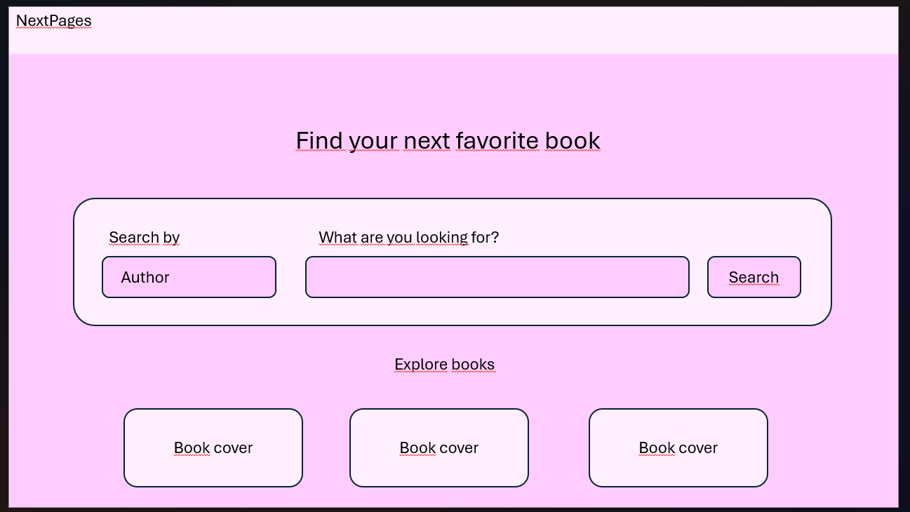
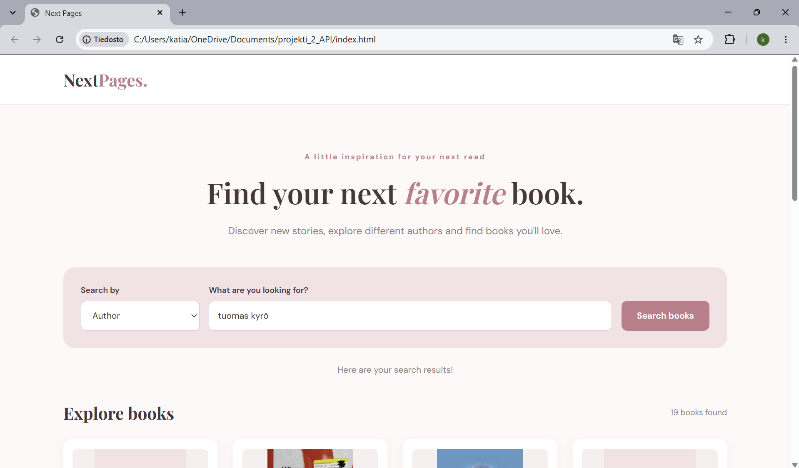

# NextPages

**Tekijä(t):** Kati Laakso

## Projektisuunnitelma

### Projektin idea

Sovelluksen avulla voi hakea kirjoja kategorioittain. Sovellus on tarkoitettu henkilöille, jotka kaipaavat inspiraatiota siihen, mitä lukea seuraavaksi.

### Suunnitellut toiminnot

Listaa vähintään kolme sovellukseesi suunniteltua toimintoa:

- Toiminto 1: Voit hakea kirjoja kirjailijan mukaan.
- Toiminto 2: Voit hakea kirjoja kirjan nimen mukaan.
- Toiminto 3: Voit hakea kirjoja aiheen mukaan.

### Rautalankamalli / luonnos

Lisää tähän kuva käsin piirtämästäsi tai digitaalisesti tehdystä sovelluksen luonnoksesta. Luonnoksessa tulee näkyä sovelluksen pääasiallinen näkymä ja tärkeimmät elementit.

Esimerkki kuvan lisäämisestä:

## Verkkolinkit

- **Julkaistu sovellus:** [Lisää tähän GitHub Pages -osoite](https://yourusername.github.io/your-repository/)
- **GitHub-repositorio:** [Lisää tähän repositorion osoite](https://github.com/yourusername/your-repository)
- **Projektin videoesittely:** 

## Tietoja sovelluksesta

NextPages on verkkosovellus, joka ...

Auttaa löytämään uutta luettavaa kolmen eri kategorian perusteella.

## Teknologiat

Kuvaile, mitä teknologioita käytit ja mikä niiden rooli oli projektissasi.

- HTML – sivun rakenne
- CSS – ulkoasu ja asettelu
- JavaScript – toiminnallisuus, DOM-skriptaus ja lomakkeiden validointi
- localStorage – en käyttänyt
- Fetch API ja Open Library API -  Fetch API avulla sovellus hakee tietoa Open Libraryn rajapinnasta.

## Sovelluksen käyttö

Kirjoita lyhyet käyttöohjeet sovellukselle.

1. Avaa julkaistu sovellus yllä olevasta linkistä.
2. Täytä kentät sen perusteella millaisia kirjoja haluat etsiä.
3. Paina "search books" painiketta ja selaa vaihtoehtoja.

## Sovelluksen käynnistäminen paikallisesti

1. Kloonaa tai lataa tämä repositorio omalle koneellesi.
2. Avaa projektikansio.
3. Avaa `index.html` selaimessa.

## Kuvakaappaukset

Lisää tähän vähintään yksi kuvakaappaus toimivasta sovelluksestasi.

Esimerkki kuvan lisäämisestä:

(img/screenshot2.png)

## Tunnetut virheet / puutteet

Kerro, jos sovelluksessa on tunnettuja virheitä, puuttuvia toimintoja tai muita rajoituksia.

Jos tunnettuja virheitä ei ole, kirjoita: **Ei tunnettuja virheitä.**

## Työn jakautuminen

## Oma arvio ja oppimisen reflektointi

Pohdi työtäsi ja oppimisprosessiasi.

- Missä onnistuin?
- Mikä oli haastavaa?
- Mitä parantaisin, jos aikaa olisi enemmän?
- Mitä opin HTML:stä, CSS:stä, JavaScriptistä ja DOM-skriptauksesta?
- Mikä jäi epäselväksi tai mistä haluaisin oppia lisää?
- Oma arvio projektista: **xx/10 pistettä**

Onnistuin sovelluksen visuaalisessa ilmeessä sekä toteuttamaan toimivan hakutoiminnon. Haastavinta projektissa oli JavaScriptin toiminnallisuuden toteuttaminen ja API-rajapinnan hyödyntäminen. Jos aikaa olisi enemmän, kehittäisin sovellukseen lisää ominaisuuksia. Esimerkiksi käyttäjä voisi tallentaa suosikkikirjojaan omaan suosikkilistaan ja tarkastella niitä myöhemmin. Opin hakemaan tietoa ulkoisesta API-rajapinnasta Fetch API avulla. Antaisin projektille 7/10.

## Lähteet ja kiitokset

Listaa kaikki projektissa käyttämäsi lähteet, tutoriaalit, kuvat ja koodiesimerkit.

Jos käytit ChatGPT:tä, GitHub Copilotia tai muuta tekoälytyökalua, mainitse se tässä ja kerro lyhyesti, miten se tuki työskentelyäsi.

- [Lähteen tai tutoriaalin nimi](https://example.com/)
- [Kuvalähde](https://example.com/)
- Käytetty tekoälytyökalu: ChatGPT
  - Miten työkalua käytettiin: käytin tekoälyä apuna ideoinnissa sekä javascriptin teossa ja kommentoinnissa.

  ## Lisenssi

Tämä projekti on lisensoitu MIT-lisenssillä.

Lisätietoa lisenssin lisäämisestä GitHub-projektiin:
https://docs.github.com/en/communities/setting-up-your-project-for-healthy-contributions/adding-a-license-to-a-repository